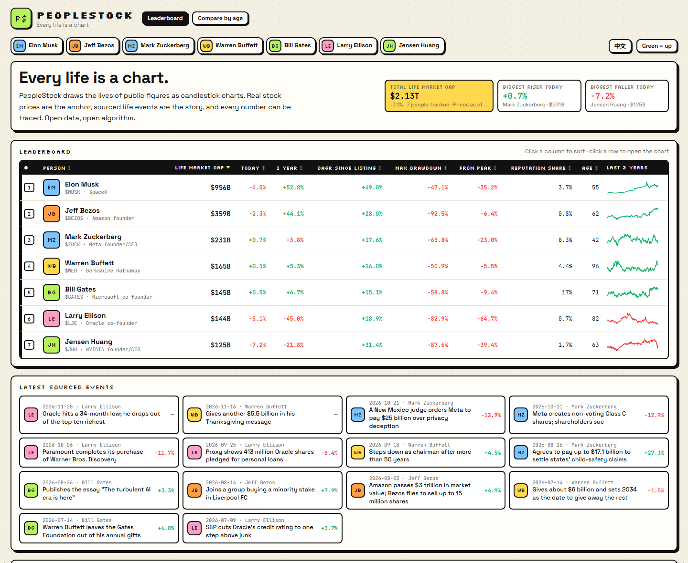
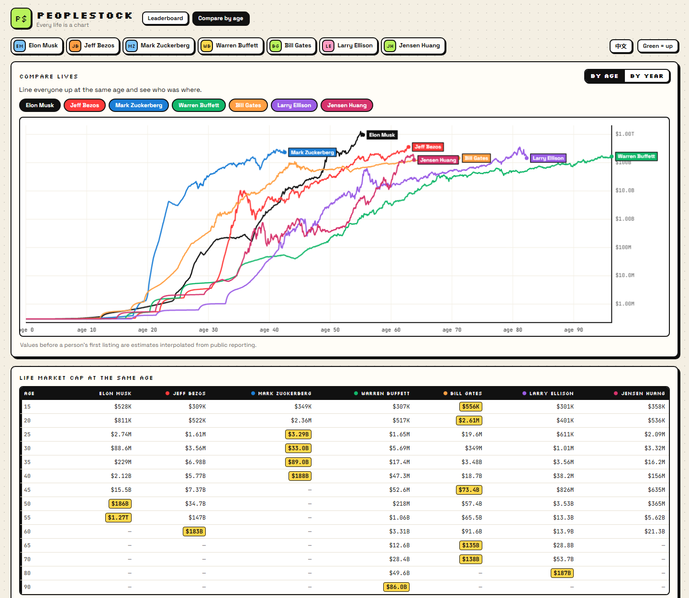

# PeopleStock 📈

**Every life is a chart.**

What if Elon Musk's life was a stock? When did Jensen Huang's "share price" bottom out? How rich was Warren Buffett at your age?

PeopleStock draws the lives of public figures as candlestick charts. Real stock prices are the anchor, sourced life events are the story, and every number can be traced back to a formula and a link.

**Live site: https://louisxu168.github.io/peoplestock/**





> Chinese name: 人生股市. The site is bilingual (English / 中文).

## What you get

- **A life as a K-line.** Daily, weekly, monthly and yearly candles from birth to today. The chart picks the right one as you zoom.
- **Numbered events.** Every flag on the chart has the same number as a row in the event table. Hover one and the other lights up. Click a row and the chart zooms to that moment.
- **"How big was it?"** For every event: the life market cap then, 30 days later and 1 year later, the attention spike, and the evidence behind it.
- **Chapters.** Each life is split into 5–7 chapters, like a table of contents. Press **Play** and watch a life unfold.
- **Leaderboard.** Life market cap, compound growth, biggest drawdown, distance from peak.
- **Compare by age.** Line people up at the same age. Jensen Huang at 30 was a chip engineer with $3M. Musk at 30 had just sold PayPal.
- **Honest by design.** Big moves with no sourced explanation are flagged as *unexplained*. The model never invents a cause.

## How a life is priced

```
life market cap = financial capital + human capital + reputation capital      (USD)
```

| Part | What it is | How it moves |
|---|---|---|
| Financial capital | ownership × shares × the real daily stock price, plus private holdings interpolated between funding rounds | every trading day |
| Human capital | present value of future earning power | climbs smoothly after degrees and career steps |
| Reputation capital | smoothed audience × $150 × a reputation coefficient | events nudge the coefficient, the nudge decays with a 2.5-year half-life |

Attention (audience, media, search) is drawn as volume. The full reasoning, with every constant, is in [docs/METHODOLOGY.md](docs/METHODOLOGY.md). The whole model is one file: [src/model.js](src/model.js).

## Run it

No build step, no dependencies. You need Python 3 only to fetch prices and serve the folder.

```bash
git clone https://github.com/louisxu168/peoplestock
cd peoplestock
python scripts/fetch_prices.py    # downloads daily prices into data/prices/
python -m http.server 8765        # then open http://localhost:8765
```

Price files are not stored in the repository. The script downloads them from Yahoo Finance, and a scheduled GitHub Action does the same before each deploy.

## Add a person, fix a number

Every person is one JSON file in [`data/people/`](data/people). To add someone or correct a score, edit that file and open a pull request. The discussion happens in the PR.

- Format: [docs/SCHEMA.md](docs/SCHEMA.md)
- Rules and scoring rubric: [CONTRIBUTING.md](CONTRIBUTING.md)
- Check your file: `node scripts/validate.mjs`

The fastest way to help: pick an **unexplained move** on any chart, find out what happened that day, and send a PR with the source.

## Ground rules

- **Estimates, not net worth.** Ownership, private valuations and audience sizes are approximations from public reporting. Nothing here is investment advice.
- **Public figures, public events.** Health, family and private life are never scored.
- **No double counting.** If the market already priced an event, the stock carries it.
- **No invented causes.** If it can't be sourced, it isn't on the chart.

If you are covered here and something is wrong, open an issue and it will be fixed or removed.

## License

Code: [MIT](LICENSE). Data in `data/people/`: [CC BY-SA 4.0](LICENSE-DATA.md). Stock prices belong to their providers and are not redistributed in this repository.
